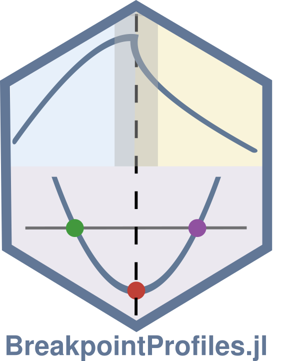

# BreakpointProfiles.jl

[](https://github.com/Mehdilotfi7/BreakpointProfiles.jl/actions/workflows/CI.yml)
[](https://codecov.io/gh/Mehdilotfi7/BreakpointProfiles.jl)
[](https://mehdilotfi7.github.io/BreakpointProfiles.jl/)

<p align="center">
  
</p>

[Full documentation is available here](https://mehdilotfi7.github.io/BreakpointProfiles.jl/).

Profile-likelihood-based uncertainty quantification for ordinary differential equation (ODE) models with fixed changepoints.

This package is designed to be used **after** a changepoint-detection step (for example with [Mica.jl](https://github.com/Mehdilotfi7/Mica.jl)), once the number and locations of changepoints have been determined. `BreakpointProfiles.jl` then quantifies the uncertainty around the fitted parameters and the detected changepoint locations via profile-likelihood methods.

The adaptive profile-likelihood engine and the confidence-interval extraction in this package were inspired by and validated against the Data2Dynamics (D2D) MATLAB profile-likelihood (Raue et al., *Bioinformatics* 2015; Raue et al., *PLOS ONE* 2013). Users familiar with D2D will recognise the D2D-style adaptive outward stepping, warm-start re-optimisation, and jump-smoothing strategy.

[ProfileLikelihood.jl](https://github.com/DanielVandH/ProfileLikelihood.jl) provides general profile-likelihood analysis for model parameters. BreakpointProfiles.jl complements it with discrete changepoint-location profiles, joint profiling in which changepoints are re-optimized as nuisance parameters, and a common API for baseline, conditional, and changepoint-aware analyses.

## Installation

The package is not yet registered in the Julia General registry. Install it
from GitHub:

```julia
using Pkg
Pkg.add(url="https://github.com/Mehdilotfi7/BreakpointProfiles.jl")
```

Or clone the repository and develop it locally:

```julia
using Pkg
Pkg.develop(path="path/to/BreakpointProfiles.jl")
```

## Quick start

```julia
using BreakpointProfiles

# Build a problem from a previously fitted changepoint model
# (see examples/baseline_and_changepoint.jl for a complete workflow)
prob = ODEChangepointPLEProblem(
    objective = (params, cps) -> my_loss(params, cps),
    data = my_data,
    loss_fn = my_loss,
    changepoints = [50, 100],
    best_params = best_fit,
    best_loss = best_loss,
    lb = lb,
    ub = ub,
    n_global = n_global,
    n_segment_specific = n_segment_specific
)

# Conditional profile-likelihood for a parameter (changepoints fixed)
prof = profile_parameter(prob, 1)

# Joint profile-likelihood for a parameter (changepoints re-optimised)
joint_prof = profile_parameter_joint(prob, 1)

# Profile a changepoint location
cp_prof = profile_changepoint(prob, 1; window=7)

# Summarise
summary = ple_summary([prof])
```

## Baseline profile likelihood without changepoints

Use `BaselinePLEProblem` when the model has no changepoints or when you want a
baseline profile before introducing a changepoint model. It uses the same
adaptive D2D-style profiler, optimizers, confidence-interval extraction, and
reporting as the changepoint-aware API.

```julia
objective = p -> (p[1] - 3.0)^2 + (p[2] - 5.0)^2

baseline = BaselinePLEProblem(
    objective = objective,
    best_params = [3.0, 5.0],
    best_loss = 0.0,
    lb = [-10.0, -10.0],
    ub = [10.0, 10.0],
    param_names = ["x", "y"]
)

baseline_profile = profile_parameter(baseline, 1)
baseline_profiles = profile_all_parameters(baseline)
```

## Parallel computation

Start Julia with the desired number of worker threads:

```bash
julia --threads=auto
```

or set `JULIA_NUM_THREADS` before launching Julia. The package parallelizes
independent work at two levels:

- **Across profiles:** `profile_all_parameters` evaluates independent parameter
  profiles on Julia threads when the selected inner optimizer is serial.
  `profile_all_parameters_joint` provides the same option for joint profiles.
  For large models, independent parameters can also be assigned to separate
  cluster jobs, such as SLURM array tasks.
- **Within a profile:** compatible population-based optimizers can evaluate
  their populations on threads. During joint profiling, the discrete
  changepoint grid can also be evaluated in parallel with
  `parallelize_grid=true`.

Avoid nested parallelism that oversubscribes the CPU. When the inner optimizer
uses threads, the batch drivers process profiles serially so that each inner
optimization can use the available workers. For joint profiling,
`parallel_over_parameters=true` disables grid-level threading inside each
profile; setting it to `false` allows the CP grid to use threads instead.

For cluster workflows, write each profile's results to a separate output file
and combine them after all jobs finish. Parallelism changes runtime, not the
profiling method or confidence threshold.

## Features

- **Baseline profile likelihood** for models without changepoints.
- **Conditional profile likelihood** for continuous parameters (changepoints fixed).
- **Joint profile likelihood** for continuous parameters (changepoints treated as discrete nuisance variables and re-optimised).
- **Changepoint-location profiling** with re-optimisation of all other parameters.
- D2D-style adaptive stepping (path extrapolation, trial-step control,
  jump smoothing) with bisection refinement of every threshold crossing.
- Multiple optimiser backends: GA (Evolutionary.jl), differential evolution (Metaheuristics.jl), LBFGS (Optim.jl), BOBYQA (NLopt.jl), and multi-start/hybrid pipelines.
- Likelihood options: Gaussian (L2), Laplace (L1), log-scale, and custom losses.
- Identifiability assessment and confidence-interval extraction.
- CSV/DataFrame export, Markdown reports, and plotting utilities.

## Losses and thresholds

The loss must be `-2 log L` of the observation model for the χ²₁ threshold
(`delta = 3.8415`, 95%) to be meaningful, and it should be the same likelihood
that was used to detect the changepoints (loss consistency).

- `GaussianNLL(σ)`: Gaussian errors with known per-channel σ,
  `Σ ((sim - data)/σ)²`.
- `ProfiledGaussianNLL()`: Gaussian errors with one unknown σ profiled out,
  `N log(RSS/N)` — the likelihood implied by the MICA BIC.
- `GaussianLogNLL(σ)`, `GaussianLogLikelihood(σ)`: Gaussian errors on log scale.
- **Raw RSS** equals `-2 log L` only if σ = 1; otherwise intervals are wrong
  by a factor σ.
- **Laplace (L1) losses:** Wilks' theorem does not apply. Pass a user-derived
  `delta` (or absolute `threshold`).

The threshold is `reference_loss + delta`. By default the reference fit is
re-optimised before profiling (`ProfileOptions(refit_reference=true)`), and if
a profile finds a better optimum the reference is replaced and all profiles
are recomputed (`allow_better_optimum=true`).

## Changepoints in the generic ODE path

When `ode_function` is used instead of `objective`, segment `j` is integrated
with `p = [θ_global; θ_segment_j]` (the `n_global` global parameters followed
by the `n_segment_specific` parameters of that segment) and the state is
carried over continuously at each changepoint. The right-hand side therefore
never needs to know the changepoint locations, and moving a changepoint
changes the dynamics.

## Changepoint uncertainty

- `profile_changepoint` / `profile_all_changepoints`: discrete profile of one
  changepoint location (`window`, `min_seg`).
- `cp_confidence_set`: all locations below the threshold, the contiguous
  component around the minimum, secondary components, and whether the set is
  censored by the profiling window (`identifiable == false` in that case).
- `profile_parameter_joint`: the changepoints are profiled out over the fixed
  search set `CPSearchSpace(detected, window, n_obs; step, min_seg)`, either
  exhaustively (`cp_search=:grid`) or by coordinate search
  (`cp_search=:local`, for many changepoints). Admissible secondary
  changepoint configurations are tracked, so disconnected confidence regions
  are reported (`profile_confidence_intervals`).

The χ²₁ calibration of changepoint-location sets is heuristic because a
discrete changepoint location is a non-regular parameter; in simulation
studies it gives close to nominal coverage, but a parametric bootstrap is the
rigorous alternative.


## Citation

If you use this package in research, please cite the MICA paper.

## License

MIT
